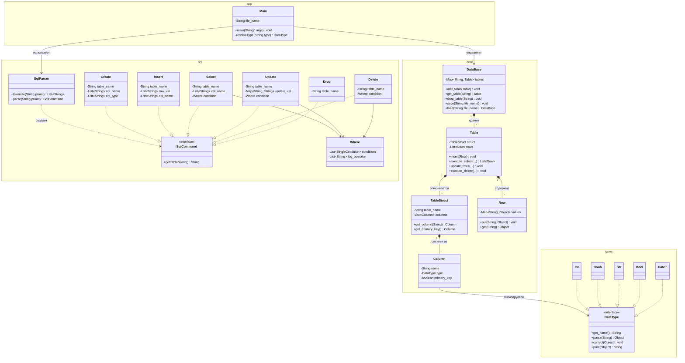
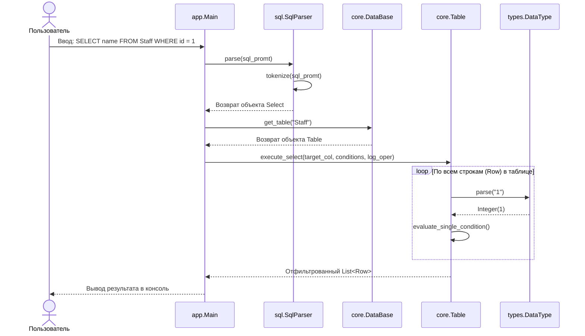

# Разработка упрощённой системы управления базами данных (СУБД) на Java

## 1. Архитектура системы
* /types - содержит классы основных типов (Int, Doub, Str, Bool)
* /core - классы, которые описывают таблицы и хранят данные
* /sql - разделение принятого SQL запроса на  отдельные логические слова (SqlParser) и модель команд (Create, Drop, Insert, Select, Update, Delete, Where), реализующих единый интерфейс SqlCommand.
* /app - точка входа Main, консольный интерфейс пользователя, выбор рабочих директорий и файлов баз данных.

### Диаграмма классов (Class Diagram)



### Диаграмма последовательностей (Sequence Diagram) на примере `SELECT`



## 2. Инструкция пользователя
* Проект можно открыть и запустить из среды разработки IntelliJ IDEA, запустив метод `main` в классе `app.Main`.

### Поддерживаемые типы данных
| тип в SQL | класс в программе | описание и формат ввода | пример |
|:---|:---|:---|:---|
|`int`|`types.Int`|целое число|`52`|
|`string` / `str`|`types.Str`|текстовая строка|`'привет'`|
|`double`|`types.Doub`|число с плавающей точкой|`52.54`|
|`data`|`types.DataT`|дата в формате `дд.мм.гггг`|`18.07.2005`|
|`bool`|`types.Bool`|логическое значение `true` или `false`|`true`|

### Пример поддерживаемых SQL команд:
1. **Создание таблицы** *(по умолчанию первый столбец идет со значением Primary Key)*
```sql
CREATE TABLE Staff (id int, name string, position string, birthday data, has_children bool);
```

2. **Вставка записей** *(полная и с указанием конкретных столбцов)*
```sql
INSERT INTO Staff VALUES (1, 'Иван Иванов', 'Разработчик', '15.05.1995', false);
INSERT INTO Staff (id, name, position) VALUES (2, 'Анна Петрова', 'Дизайнер');
```

3. **Выборка данных** *(поддерживается условие `WHERE` и логические операторы внутри него `AND` и `OR`)*
```sql
SELECT * FROM Staff;
SELECT name, position FROM Staff;
SELECT name FROM Staff WHERE position = 'Дизайнер';
SELECT * FROM Staff WHERE id = 1 AND position = 'Разработчик';
SELECT name FROM Staff WHERE id = 1 OR position = 'Дизайнер';
```

4. **Обновление записей**
```sql
UPDATE Staff SET position = 'Тимлид', has_children = true WHERE id = 1;
```

5. **Удаление записей**
```sql
DELETE FROM Staff WHERE position = 'Дизайнер';
```

6. **Удаление таблицы**
```sql
DROP TABLE Staff;
```

## 3. Распределение ролей в команде
* **Сахарнова Любовь** полная реализация папок `/sql` и `/app`
* **Чудакова Екатерина** полная реализация папок `/types` и `/core`

## 4. Вывод
В ходе выполнения этой работы мы с нуля спроектировали и написали на языке Java собственную мини-СУБД, которая умеет работать с таблицами и понимать **базовые SQL-запросы**.
Работа в команде потребовала от нас заранее договориться об общей архитектуре и интерфейсах взаимодействия, чтобы наши части кода без проблем работали друг с другом. Применение принципов **ООП** (интерфейсов, полиморфизма и инкапсуляции) помогло четко разделить зоны ответственности и разбить проект на 4 независимых пакета:

* **Парсер** (sql) - с помощью регулярных выражений разбирает текстовый ввод пользователя и превращает его в понятные программе объекты-команды (Create, Insert, Select, Update, Delete, Drop), включая разбор цепочек условий WHERE с операторами AND и OR.
* **Система типов** (types) - следит за тем, чтобы в таблицу не попали некорректные данные, она проверяет и переводит строки в целые и дробные числа, даты и логические значения.
* **Ядро** (core) - отвечает за внутреннее устройство таблиц, проверку уникальности первичного ключа (Primary Key), фильтрацию строк и физическое сохранение всей базы данных в файл на диск с помощью стандартного механизма сериализации Java (Serializable).
* **Консольный интерфейс** (app) - связывает все части вместе, позволяет выбирать рабочие папки и файлы баз данных, а также защищает программу от аварийного падения при опечатках пользователя благодаря перехвату исключений (try-catch).

В результате у нас получилась полностью рабочая консольная СУБД, которая надежно сохраняет данные между запусками и корректно обрабатывает все основные операции. Помимо технических навыков работы с потоками ввода-вывода, регулярными выражениями и коллекциями Java, этот проект дал нам хороший опыт командной разработки и интеграции модулей.
В дальнейшем эту систему можно улучшить: добавить хэш-индексы для более быстрого поиска на больших объемах данных и реализовать объединение таблиц (JOIN).
